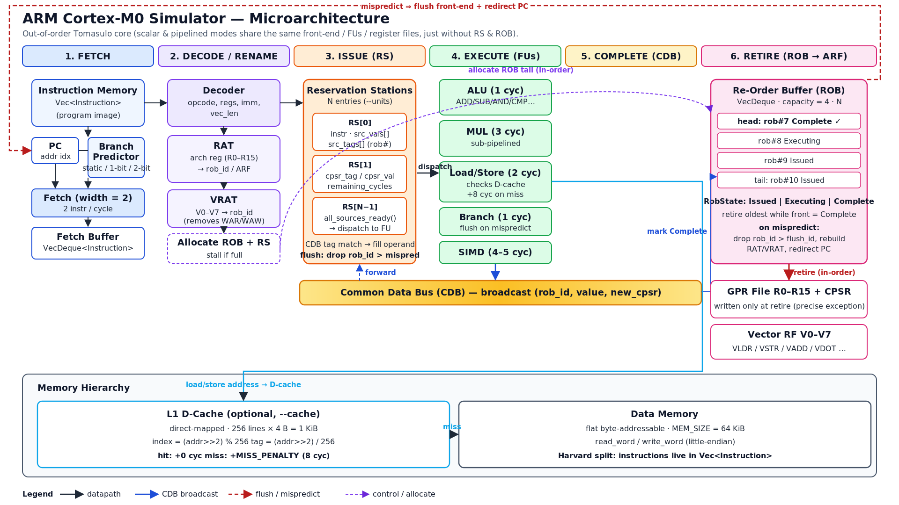

# ARM Cortex-M0 Processor Simulator

A cycle-accurate processor simulator for a reduced ARM Thumb instruction subset,
built entirely in Rust with **zero external dependencies**.

Three simulation modes are supported:

| Mode     | Flag             | Description                                            |
|----------|------------------|--------------------------------------------------------|
| Scalar   | `--sim scalar`   | Non-pipelined, single-issue fetch–decode–execute loop  |
| Pipeline | `--sim pipeline` | In-order 5-stage pipeline (IF–ID–EX–MEM–WB) with multiple execution units, hazard detection & optional forwarding |
| OoO      | `--sim ooo`      | Out-of-order superscalar with Tomasulo scheduling, ROB, and register renaming |



## Prerequisites

- Rust toolchain (`rustc` + `cargo`), edition 2021 or later — install from <https://rustup.rs>
- Verify with: `rustc --version` and `cargo --version`

## Build

```bash
make                     # uses the included Makefile
# or directly:
cargo build --release
```

## Usage

```bash
cargo run --release -- [OPTIONS] <program.asm>
```

```bash
# Run GCD on the scalar simulator
cargo run --release -- src/programs/gcd.asm

# Fibonacci on the OoO simulator with 4 units and a 2-bit predictor
cargo run --release -- --sim ooo --units 4 --predictor 2bit src/programs/fibonacci.asm

# Pipelined simulator with forwarding and L1 data cache
cargo run --release -- --sim pipeline --forwarding --cache src/programs/cache_sequential.asm

# Compare all simulator configurations on one program
cargo run --release -- --batch src/programs/bubble_sort.asm

# Run the full experiment suite (run from the project root)
cargo run --release -- --experiment

# Verbose per-cycle trace for debugging
cargo run --release -- --sim scalar --verbose src/programs/bitcount.asm
```

### Command-line options

```
--sim <mode>         scalar | pipeline | ooo  (default: scalar)
--units <N>          Execution units / reservation stations (default: 2)
--predictor <kind>   static | 1bit | 2bit  (default: static)
--forwarding         Enable data forwarding (pipeline mode)
--cache              Enable L1 data cache simulation (pipeline / ooo modes)
--verbose, -v        Print per-cycle execution trace
--batch              Run all simulator configurations and print a comparison table
--experiment         Run the full experiment suite on src/programs/
--help               Print usage
```

### Sample output

`--batch` runs the same program on every configuration and prints a comparison:

```
Batch Comparison: src/programs/bubble_sort.asm

Simulator        Cycles   Instrs      IPC   Br.Pred%     Stalls
----------------------------------------------------------------------
scalar             1213      377   0.3108          -          0
pipeline-1          701      377   0.5378      45.3%        261
pipeline-N          647      377   0.5827      45.3%        207
ooo                 516      377   0.7306      45.3%          0
```

## Architecture

### Instruction set

Reduced ARM Thumb-like ISA with **41 instructions**:

| Category          | Instructions                                              |
|-------------------|-----------------------------------------------------------|
| Arithmetic & compare | ADD, ADDI, SUB, SUBI, MUL, CMP, CMPI                   |
| Logical & shift   | AND, ORR, EOR, MVN, LSL, LSR, ASR                         |
| Data movement     | MOV, MOVI                                                 |
| Memory & stack    | LDR, STR, LDRB, STRB, LDRPOST, STRPOST, PUSH, POP         |
| Control flow      | B, BEQ, BNE, BLT, BGE, BGT, BLE, BL, BX                   |
| Vector (SIMD)     | VLDR, VSTR, VADD, VSUB, VMUL, VDOT                        |
| Special           | NOP, HALT                                                 |

Post-indexed addressing (LDRPOST/STRPOST) fuses a memory access with an
automatic base-register increment, reducing instruction count in array loops.

Registers: 16 GPRs (R0–R12, SP, LR, PC), CPSR flags (N/Z/C/V), and a separate
vector register file V0–V7 (up to 64 × 32-bit elements each). Data memory is a
flat 64 KiB byte-addressable, little-endian space.

### Pipelined simulator

- 5-stage pipeline: IF – ID – EX – MEM – WB
- Data hazard detection with stalling and optional forwarding (`--forwarding`)
- CPSR (flag) hazard detection for conditional branches
- Control hazard handling via flush on misprediction
- Configurable execution units (1 = scalar pipeline, >1 = superscalar), sub-pipelined with per-opcode latency
- In-order retirement via sequence numbers

### Out-of-order simulator

- Reservation stations (Tomasulo algorithm)
- Re-order buffer (ROB) for in-order retirement
- Register renaming via RAT; separate VRAT for vector registers
- Common Data Bus (CDB) broadcast, including CPSR forwarding for conditional branches
- Speculative fetch with misprediction recovery (flush + redirect)
- Stages: Fetch → Decode/Rename → Issue → Execute → Complete → Retire

### Branch prediction

Selectable with `--predictor`: static (always not-taken), 1-bit, or 2-bit
saturating counter (per-branch-address tables).

## Extensions

### L1 data cache

- Direct-mapped, 256 lines × 1 word = 1 KiB
- Hit: no additional latency; miss: +8 cycle penalty
- Enabled via `--cache`; integrated with the pipeline and OoO simulators

### Vector instructions (SIMD)

- Separate vector register file V0–V7 (up to 64 elements each)
- Six instructions: VLDR/VSTR (memory ↔ vector register), VADD/VSUB/VMUL
  (register-to-register), VDOT (dot product → scalar GP register)
- Dynamic latency scales with vector length: 1 + len cycles (VLDR/VSTR/VADD/VSUB),
  2 + len (VMUL), 2 + 2·len (VDOT)
- Integrated with all three simulators, the cache, and the experiment suite

## Benchmark programs

Twelve hand-written assembly programs in `src/programs/`:

| Program | Description |
|---------|-------------|
| `vector_add.asm` | Loop-based array addition (post-indexed) |
| `vector_add_plain.asm` | Same algorithm without post-indexed addressing |
| `vector_ops.asm` | SIMD vector operations (VADD, VMUL, VDOT) |
| `vector_ops_scalar.asm` | Scalar-loop equivalent for SIMD comparison |
| `cache_sequential.asm` | Sequential access pattern (stride-1, 3 passes) |
| `cache_strided.asm` | Strided access pattern (stride-16, 3 passes) |
| `cache_conflict.asm` | Pathological conflict-miss pattern |
| `fibonacci.asm` | Iterative Fibonacci (data-dependency stress test) |
| `bubble_sort.asm` | Nested loops with many conditional branches |
| `gcd.asm` | Euclidean algorithm (tight conditional loop) |
| `bitcount.asm` | Population count (shift & mask loop) |
| `factorial.asm` | Recursive function with PUSH/POP/BL/BX |

## Experiments

See [`experiments.md`](experiments.md) for three hypothesis-driven experiments,
all reproducible with `cargo run --release -- --experiment`:

1. Post-indexed addressing impact on instruction count and cycles (ISA enhancement)
2. Cache locality & conflict-miss analysis across access patterns (cache extension)
3. SIMD vector-length scaling — speedup vs. vector size (SIMD extension)

## Project structure

```
Cargo.toml
Makefile
experiments.md         Experiment write-up (hypothesis → method → results)
microarchitecture.png  OoO microarchitecture diagram
src/
  main.rs          Entry point, CLI, experiment runner
  isa.rs           Instruction set definition (opcodes, operands, latencies)
  assembler.rs     Two-pass text assembler
  memory.rs        Flat 64 KiB data memory (byte-addressable, little-endian)
  regs.rs          Register file with CPSR flag management + vector registers
  execute.rs       Instruction execution engine
  stats.rs         Performance counters (cycles, IPC, branch accuracy, ...)
  branch_pred.rs   Branch prediction (static / 1-bit / 2-bit)
  cache.rs         L1 direct-mapped data cache
  sim_scalar.rs    Non-pipelined simulator
  sim_pipeline.rs  5-stage pipelined simulator with multiple execution units
  sim_ooo.rs       Out-of-order superscalar simulator (Tomasulo + ROB)
  programs/        Benchmark assembly programs (12 × .asm)
```

## Assembly syntax

```asm
; line comment
.data 0x1000            ; data section at base address (default 0x1000)
arr:  .word 1, 2, 3, 4

.text
      MOVI R0, #0x1000  ; immediates: #decimal or #0xHEX
loop: LDRPOST R1, R0, #4
      CMP  R1, R2
      BNE  loop
      HALT
```

Registers `R0`–`R12`, `SP`, `LR`, `PC`; labels end with `:`. The stack pointer
is initialised to the top of data memory (0xFFFC).
