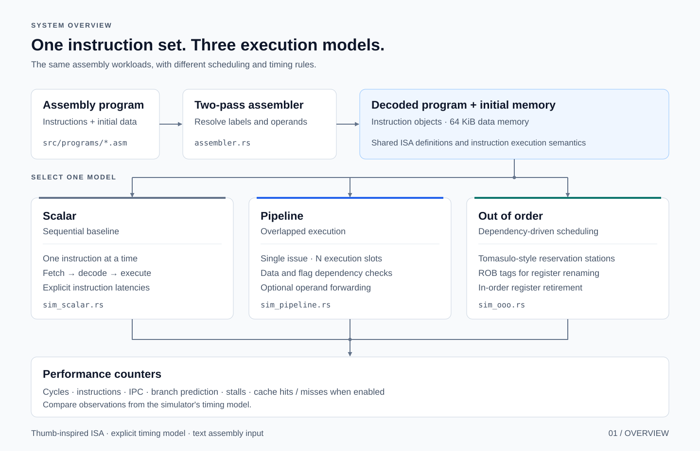
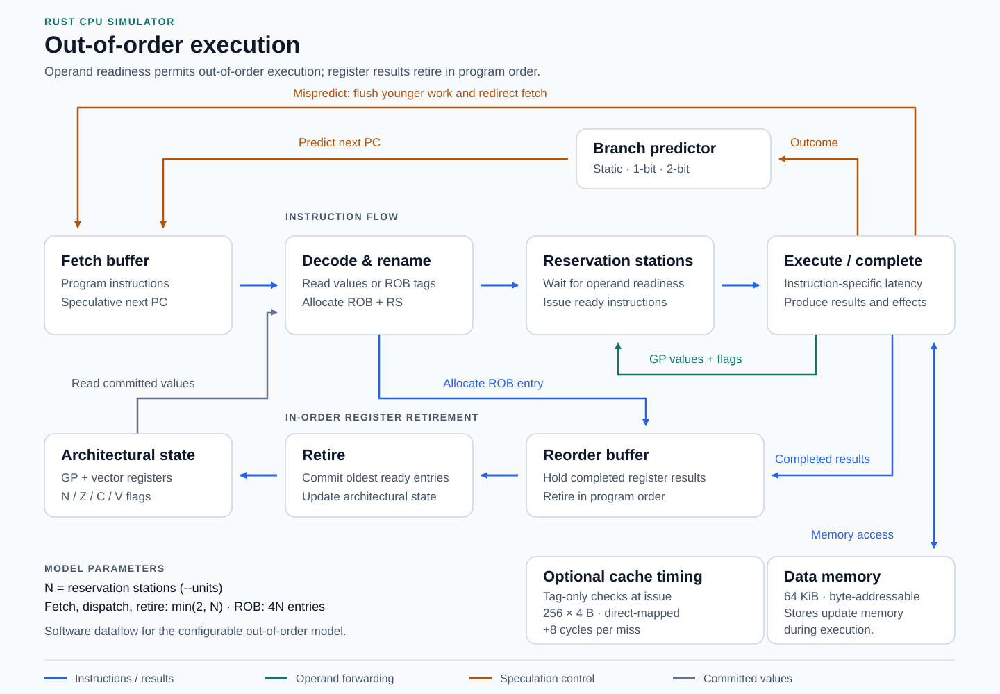

# Arm Cortex-M0 Simulator

A Rust CPU simulator built around a custom Thumb-inspired instruction set and
explicit cycle model. Explore instruction scheduling, branch prediction, and memory
access by running the same assembly program through scalar, pipelined, and
out-of-order models, then compare cycle counts, IPC, and stalls.



## Core design

The models share a two-pass assembler, instruction definitions, machine-state
types, and an execution engine. Each run starts with fresh registers and memory.

| Model | Implementation |
|---|---|
| [Scalar](src/sim_scalar.rs) | Executes one instruction at a time, accounting for fetch, decode, and execution latency. |
| [Pipeline](src/sim_pipeline.rs) | Issues at most one instruction per cycle into configurable execution slots, with dependency stalls and optional operand forwarding. |
| [Out of order](src/sim_ooo.rs) | Uses Tomasulo-style reservation stations, ROB-tag register renaming, result broadcasts, and in-order register retirement. |

Three branch predictors—static not-taken, 1-bit, and 2-bit—make control-flow behavior
configurable. Extensions add post-indexed loads/stores, a direct-mapped cache
timing model, and six custom vector instructions.



## Run

Install Rust and Cargo, then run from the repository root:

```bash
git clone https://github.com/Philjae-Shin/arm-cortex-m0-simulator.git
cd arm-cortex-m0-simulator

# Start with the sequential GCD program.
cargo run --release -- --sim scalar src/programs/gcd.asm
```

Compare execution models on the same workload:

```bash
cargo run --release -- --batch --units 4 --predictor 2bit --forwarding \
  src/programs/bubble_sort.asm
```

The four rows are scalar, pipeline with one slot, pipeline with four slots,
and OoO with four reservation stations. `Cycles` is modeled execution time;
`IPC` is executed instructions divided by cycles.

Enable cache timing for an individual run:

```bash
cargo run --release -- --sim pipeline --units 2 --predictor 2bit \
  --forwarding --cache src/programs/cache_sequential.asm
```

Use `--verbose` for execution traces and `--help` for the complete CLI.
`--units` selects execution slots in pipeline mode and reservation stations in OoO
mode. `--forwarding` applies to the pipeline.

## Experiments

```bash
cargo run --release -- --experiment
```

The built-in suite explores three questions with fixed configurations:

| Question | Comparison |
|---|---|
| What does post-indexed addressing save? | Explicit pointer increments versus `LDRPOST` / `STRPOST`. |
| How do reuse and conflicts affect cache penalties? | Repeated sequential, strided, and conflicting accesses. |
| How does vector length affect loop overhead? | Scalar loops versus custom vector operations at lengths 2–32. |

See [experiment methods and interpretation](experiments.md) for configurations,
commands, and the meaning of each counter.

## Implementation details

- **ISA and state:** 41 custom Thumb-like operations, 16 scalar registers (including
  SP, LR, and PC), N/Z/C/V condition flags, eight vector registers, and 64 KiB of
  little-endian data memory. The assembler creates decoded instruction objects.
- **Timing:** Instruction latencies are explicit model parameters. The optional
  cache models 256 direct-mapped, 4-byte lines through tag checks and an eight-cycle
  miss penalty. Vector latency scales with vector length.

## Code to explore

| Area | Source |
|---|---|
| Assembly parsing, operands, and instruction latency | [assembler.rs](src/assembler.rs), [isa.rs](src/isa.rs) |
| Shared instruction semantics | [execute.rs](src/execute.rs) |
| Dependency checks and forwarding | [sim_pipeline.rs](src/sim_pipeline.rs) |
| Rename tables, reservation stations, and retirement | [sim_ooo.rs](src/sim_ooo.rs) |
| Predictor policies and cache timing | [branch_pred.rs](src/branch_pred.rs), [cache.rs](src/cache.rs) |
| CLI, batch comparisons, and experiments | [main.rs](src/main.rs) |
